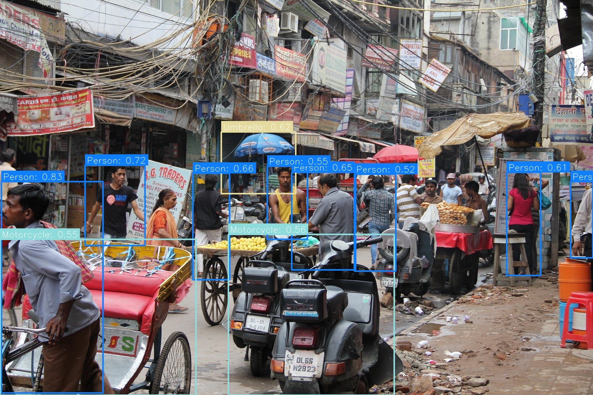

# PixelFlow

<!--
summary: Turn the output of any detection, segmentation or classification model into one format you can filter, track, count and draw.
label: PixelFlow
keywords: pixelflow, computer vision, object detection, annotation, tracking
template: docs
-->

Every model returns its results in its own shape: Mayaku, Ultralytics, Detectron2 and
Transformers each have their own objects, field names and box formats. PixelFlow converts
them into one format, so the code that comes after the model (filtering, tracking, counting
objects in a zone, drawing the results, writing a video) is written once and works with any
of them.

## Install

```bash
pip install pixelflow
```

PixelFlow needs Python 3.10 or newer. It does not install a model: install the one you use
next to it. The examples in these docs use [Mayaku](https://emrah.fr/mayaku/):

```bash
pip install mayaku
```

## Quick start

Detect the objects in a street photo, keep the confident ones, and draw them:

```python
import pixelflow as pf
from mayaku import from_pretrained

predictor = from_pretrained("mayaku-n-det")
result = predictor("street.jpg")
detections = pf.from_mayaku(result, labels=predictor.class_names)
detections = detections.filter_by_confidence(0.5)

image = pf.read_image("street.jpg")
image = pf.annotate.box(image, detections)
image = pf.annotate.label(image, detections)
pf.save_image("street-annotated.jpg", image)
```



What happens in each step:

- `pf.from_mayaku` turns Mayaku's result into a `Detections` object. Passing
  `predictor.class_names` gives each detection its class name ("Person", "Motorcycle")
  instead of a bare number.
- `filter_by_confidence(0.5)` keeps the detections with a confidence of 0.5 or more. Every
  filter returns a new `Detections`, so filters can be chained.
- `pf.annotate.box` and `pf.annotate.label` each draw the detections on the image and
  return it, so drawing steps chain the same way. They draw on the array you pass in; pass
  `image.copy()` if you still need the original.

Images in PixelFlow are NumPy arrays in RGB order: `pf.read_image` returns one and
`pf.save_image` writes one.

## Next steps

- [Detections](/docs/core-concepts/detections.md): the format every model result is
  converted into, and what each detection holds.
- [Converters](/docs/core-concepts/converters.md): the models and frameworks PixelFlow reads
  results from.
- [Filters](/docs/core-concepts/filters.md): keep only the detections you need, by
  confidence, class, size or position.
- [Visualization](/docs/visualization/overview.md): every way to draw results on an image.
- [Tracking](/docs/tracking/tracker.md): follow objects from frame to frame in a video.
