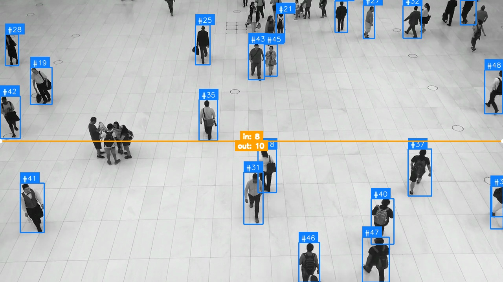

# Count objects crossing a line

<!--
summary: Count the tracked objects that cross a line in a video, in each direction and per class, with pf.Crossings.
label: Line crossings
keywords: pixelflow, line crossing, line counter, people counting, in out count
-->

A counting line across a doorway, a road or a corridor tells you how many objects passed, and
which way. `pf.Crossings` follows the position of each object a [tracker](/docs/tracking/tracker.md)
follows, and counts it when it goes from one side of a line to the other.

```python
import pixelflow as pf
from mayaku import from_pretrained

predictor = from_pretrained("mayaku-n-det")
person = predictor.class_names.index("Person")

video = pf.VideoReader("crowd.mp4")
tracker = pf.tracker.ByteTrack(frame_rate=video.fps)
crossings = pf.Crossings()
middle = crossings.add_crossing(start=(0, 360), end=(1280, 360), name="Middle", color=(255, 160, 0))
events = []

with pf.VideoWriter("crowd-crossings.mp4", like=video) as writer:
    for index, frame in enumerate(video):
        result = predictor(frame[:, :, ::-1], conf=0.1)  # Mayaku reads arrays as BGR
        detections = pf.from_mayaku(result, labels=predictor.class_names)
        people = tracker.update(detections.filter_by_class_id(person)).filter_tracked_objects()
        crossings.update(people)

        for detection in people:
            for event in detection.line_crossings:
                events.append((index, detection.tracker_id, event["direction"]))

        frame = pf.annotate.box(frame, people)
        frame = pf.annotate.label(frame, people, "#{tracker_id}")
        frame = pf.annotate.crossings(frame, crossings)
        writer.write(frame)

print(f"in: {middle.in_count}, out: {middle.out_count}")
print("first crossings (frame, id, direction):", events[:3])
```

```text
in: 8, out: 10
first crossings (frame, id, direction): [(7, 9, 'out'), (13, 3, 'in'), (41, 8, 'out')]
```



Counting needs tracker ids: they tell `Crossings` that the box above the line in this frame is the
same person as the box below it in the last one. If no detection has had an id after 10 frames,
each line warns once. [`pf.annotate.crossings`](/docs/visualization/crossings.md) draws each line with its
two counts.

## Which way is "in"

A line goes from `start` to `end`. Standing on `start` and looking towards `end`, an object that
crosses from your right to your left is counted **in**, and from your left to your right **out**.

The example's line goes from the left edge to the right edge, so "in" is going up the image: over
the 341 frames, 8 people crossed it going up and 10 going down. Person #3 crossed in at frame 13,
from below the line to above it. To swap the two directions, swap `start` and `end`.

## When a crossing counts

On every frame, `Crossings` takes one point of each tracked box, its `triggering_anchor`, and
notes which side of the line it is on. Any of the nine points of the
[anchors](/docs/visualization/anchors.md) page works; zone tests such as `"overlap"` and lists of
points raise a `ValueError`.

- **The point must be level with the line.** Objects beyond the ends of the line, by more than
  `boundary_margin` (50 pixels), are ignored, so a short line across a doorway does not count
  people walking past it.
- **The object must stay on the new side** for `minimum_crossing_threshold` frames (1 by
  default) before the crossing counts. Raise it if a box shaking on the line counts several times.
- **One object counts at most once every `debounce_time` frames** (30 by default), in either
  direction.

The anchor is `"center"` by default, the middle of the box. With `triggering_anchor="bottom_center"`,
where people's feet are, the example counts 9 in and 9 out instead of 8 and 10.

## Counts per class and per object

`in_count_per_class` and `out_count_per_class` break the counts down by `class_id`:

```python
print(middle.in_count_per_class, middle.out_count_per_class)
```

```text
{0: 8} {0: 10}
```

Here every object is a person (class 0); with every class tracked, cars and people would be
counted apart. `crossings.get_crossing_counts()` returns all of these for every line, by line id.

On the frame where an object crosses, `crossings.update` adds the crossing to the detection's
`line_crossings`, a list of `{"line_id", "line_name", "direction"}`: that is how the example
collects its events. It changes the detections in place and also returns them.
`crossings.reset_all_counts()` starts every count again from zero.

## Parameters

`crossings.add_crossing(...)`:

| Parameter | Default | |
|-----------|---------|---|
| `start`, `end` | | the two ends of the line, as `(x, y)` in pixels |
| `line_id` | the next free number | a number or a name to find the line by |
| `name` | `"Crossing <id>"` | the name of the line, in `line_crossings` |
| `color` | | RGB color to draw the line in |
| `triggering_anchor` | `"center"` | the point of the box that crosses the line |
| `minimum_crossing_threshold` | `1` | frames an object must stay on the new side |
| `boundary_margin` | `50.0` | pixels beyond each end of the line that still count |
| `debounce_time` | `30` | frames before the same object can count again |
| `minimum_distance` | `10.0` | pixels an object must have moved, over its recent crossings |
| `metadata` | `{}` | anything you want to keep with the line |
