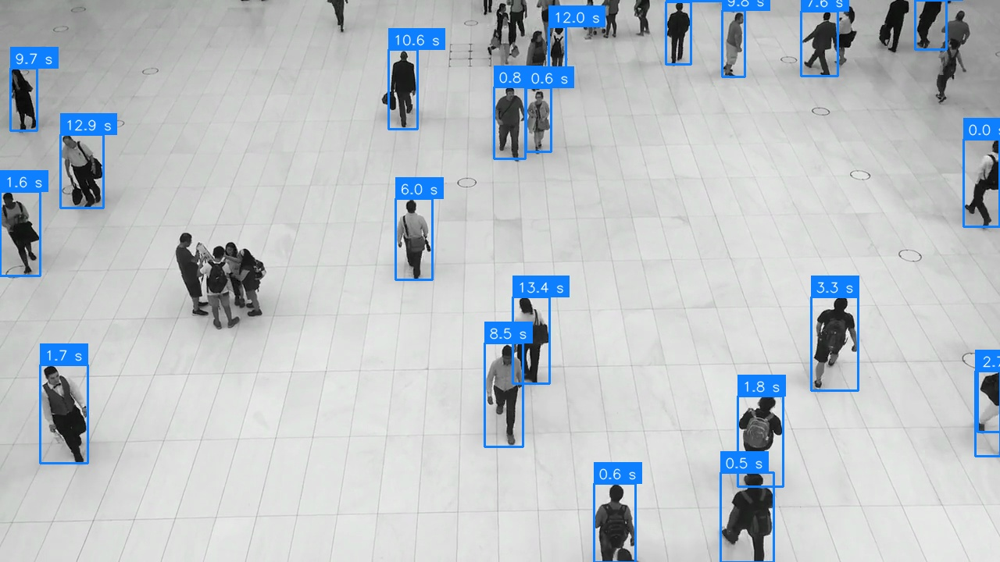

# Measure how long objects stay in view

<!--
summary: Measure how long each tracked object has been in a video, and since when it is in a zone, with pf.TimeTracker.
label: Time in view
keywords: pixelflow, dwell time, time in view, tracking duration, time tracker
-->

How long a customer stands at a shelf, how long a car waits at a gate, how long a visitor stays in
a hall: all start with knowing since when each object has been there. `pf.TimeTracker` remembers
the first frame each [tracker](/docs/tracking/tracker.md) id appeared on, and writes on every
detection how long ago that was.

```python
import pixelflow as pf
from mayaku import from_pretrained

predictor = from_pretrained("mayaku-n-det")
person = predictor.class_names.index("Person")

video = pf.VideoReader("crowd.mp4")
tracker = pf.tracker.ByteTrack(frame_rate=video.fps)
timer = pf.TimeTracker(fps=video.fps)

with pf.VideoWriter("crowd-time.mp4", like=video) as writer:
    for frame in video:
        result = predictor(frame[:, :, ::-1], conf=0.1)  # Mayaku reads arrays as BGR
        detections = pf.from_mayaku(result, labels=predictor.class_names)
        people = tracker.update(detections.filter_by_class_id(person)).filter_tracked_objects()
        people = timer.update(people)

        frame = pf.annotate.box(frame, people)
        frame = pf.annotate.label(frame, people, [f"{d.total_time:.1f} s" for d in people])
        writer.write(frame)

longest = max(people, key=lambda d: d.total_time)
print(f"#{longest.tracker_id}: in view for {longest.total_time:.1f} s, since {longest.first_seen_time:.2f} s")
print(len(people.filter_by_tracking_duration(min_seconds=2)), "of", len(people), "people seen for 2 s or more")
```

```text
#16: in view for 13.4 s, since 0.16 s
13 of 22 people seen for 2 s or more
```



`timer.update` sets two fields on each tracked detection:

- `total_time`: seconds since the object's first frame, 0 on that frame.
- `first_seen_time`: when that first frame was, in seconds from the start of the video.

Person #16 first appeared at 0.16 s, the fifth frame, and was still in view on the last frame,
13.4 s later. The video lasts 13.6 s. Detections without a tracker id get a `total_time` of 0.
`update` changes the detections in place and also returns them.

## Video time or clock time

Pass `fps` for a file: time is then counted in frames, so the times do not depend on how fast the
video is processed. Without `fps` (or with `fps=None`, which `VideoReader.fps` gives for a file
that does not report its frame rate), `TimeTracker` uses the computer's clock and
`first_seen_time` is a Unix timestamp: right for a live camera, wrong for a file.

## Time in a zone

After [`Zones`](/docs/tracking/zones.md) has marked which zone each detection is in, `TimeTracker`
also notes when each object first entered each zone. So in the loop, call `zones.update(people)`
before `timer.update(people)`, with this zone set up before it:

```python
zones = pf.Zones()
zones.add_zone([(400, 250), (900, 250), (900, 550), (400, 550)], trigger_strategy="bottom_center")
```

After the loop, `get_detailed_stats` reports, for the objects of the last frame that are in a
zone, the seconds since they first entered it:

```python
stats = timer.get_detailed_stats(people)
print(stats["zones"])
```

```text
{0: [3.12, 8.64]}
```

On the last frame of the video, two people are in zone 0, one who entered 3.1 s ago and one who
entered 8.6 s ago. The time runs from the first entry: an object that leaves the zone and comes
back is not restarted. `stats["total"]` holds every detection's `total_time` as an array.

## Keep only objects that stayed

Two filters use what `TimeTracker` writes (see [tracked objects](/docs/core-concepts/filters.md#tracked-objects)):

```python
regulars = people.filter_by_tracking_duration(min_seconds=2)
newcomers = people.filter_by_first_seen_time(start_time=10)
```

`timer.get_tracker_stats(16)` returns one id's times. `TimeTracker` remembers every id it has
seen: on a long stream, call `timer.cleanup_inactive_trackers(ids)` now and then with the ids
still in view to forget the others, and `timer.reset()` to forget all of them.

## Parameters

`pf.TimeTracker(fps=None)` takes one parameter, `fps`: the video's frame rate, so times are counted
in frames. Without it, times come from the computer's clock.
