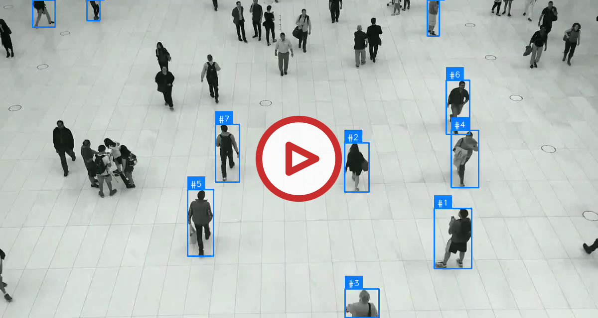

# Track objects with a moving camera

<!--
summary: Keep tracker ids stable when the camera pans or shakes, with BoT-SORT's camera motion compensation in pf.tracker.
label: Moving camera
keywords: pixelflow, camera motion compensation, botsort, object tracking, moving camera
-->

A tracker predicts where each object will be in the next frame from how it moved so far. When the
camera moves, every object jumps in the image at once, the predictions miss, and the tracker
starts new ids for objects it was already following. `pf.tracker.BoTSORT` measures the camera's
motion between frames and moves its predictions with it before matching.

To try it without footage from a moving camera, make some: this script
[crops](/docs/utilities/transforms.md) `crowd.mp4` at a spot that jumps by up to 40 pixels each
frame, like a shaking hand-held camera:

```python
import numpy as np
import pixelflow as pf

rng = np.random.default_rng(0)
video = pf.VideoReader("crowd.mp4")
with pf.VideoWriter("crowd-shaky.mp4", like=video) as writer:
    for frame in video:
        dx, dy = rng.integers(-40, 41, size=2)
        writer.write(pf.transform.crop(frame, [40 + dx, 40 + dy, 1240 + dx, 680 + dy]))
```

Then track it as in [track objects across video frames](/docs/tracking/tracker.md), with
`pf.tracker.BoTSORT` and each frame passed to `update`:

```python
import pixelflow as pf
from mayaku import from_pretrained

predictor = from_pretrained("mayaku-n-det")
person = predictor.class_names.index("Person")

video = pf.VideoReader("crowd-shaky.mp4")
tracker = pf.tracker.BoTSORT(frame_rate=video.fps, cmc_method="orb")
ids = set()

with pf.VideoWriter("crowd-shaky-tracked.mp4", like=video) as writer:
    for frame in video:
        result = predictor(frame[:, :, ::-1], conf=0.1)  # Mayaku reads arrays as BGR
        detections = pf.from_mayaku(result, labels=predictor.class_names)
        people = detections.filter_by_class_id(person)

        people = tracker.update(people, frame=frame)
        tracked = people.filter_tracked_objects()
        ids.update(d.tracker_id for d in tracked)

        frame = pf.annotate.box(frame, tracked)
        frame = pf.annotate.label(frame, tracked, "#{tracker_id}")
        writer.write(frame)

print(len(ids), "ids")
```

```text
44 ids
```

[](https://emrah.fr/pixelflow/tracking/tracker-moving-camera/)

The shaken video holds the same people as the original, where ByteTrack gives 48 ids. Without the
frame, tracking falls apart:

| Tracker on `crowd-shaky.mp4` | Ids in all | Frames a track lasts (median) |
|------------------------------|------------|-------------------------------|
| `ByteTrack` | 539 | 5 |
| `BoTSORT(enable_cmc=False)` | 296 | 6 |
| `BoTSORT(cmc_method="orb")`, with `frame=frame` | 44 | 119 |

BoT-SORT warns once if camera motion compensation is on but `update` gets no frame.

## How the motion is measured

BoT-SORT follows points from one frame to the next and fits the camera's motion to them, a 2x3
transform made of a shift, a rotation and a zoom. Frames are RGB, as
[everywhere in PixelFlow](/docs/utilities/media.md).

`cmc_method` picks how points are followed. On `crowd-shaky.mp4`, with `update` timed on the CPU
of an Apple M1 Max:

| `cmc_method` | Ids in all | ms per frame |
|--------------|------------|--------------|
| `"sparseOptFlow"` (default) | 45 | 5.7 |
| `"orb"` | 44 | 2.5 |
| `"sift"` | 45 | 31.0 |
| `"ecc"` | 243 | 56.5 |

Use `"orb"`, as the example does: as good here and more than twice as fast as the default. `"orb"`
and `"sift"` also leave out the points inside confident detections, so people walking are not
taken for camera motion. `"ecc"` aligns whole images instead of points, with a shift and a
rotation only, and lost the 40-pixel jumps of this video. `cmc_downscale` (2) shrinks frames
before measuring: raise it for large frames.

## When you know the camera motion

A pan-tilt camera, a drone or a stabiliser may report its own motion. Pass it to BoT-SORT as
`cmc_transform`, a 2x3 matrix that moves a point of the previous frame to where it is in this one,
instead of the frame:

```python
import numpy as np

# the image moved 12 pixels left and 3 down since the previous frame
motion = np.array([[1, 0, -12], [0, 1, 3]], dtype=float)
people = tracker.update(people, cmc_transform=motion)
```

`frame` and `cmc_transform` cannot be passed together. With the exact motion of the shaken video
above, BoT-SORT gives 45 ids, and `update` takes 0.9 ms instead of 5.7 with the default method:
nothing is measured.

## OC-SORT with a moving camera

`pf.tracker.OCSORT` can measure camera motion from the frame too, but does not by default, as in
its paper, and takes no `cmc_transform`. Turn it on and pass the frame:

```python
tracker = pf.tracker.OCSORT(frame_rate=video.fps, enable_cmc=True)
people = tracker.update(people, frame=frame)
```

On `crowd-shaky.mp4`, OC-SORT gives 185 ids without it and 47 with it. See
[choose a tracker](/docs/tracking/tracker.md#choose-a-tracker) for how it differs from BoT-SORT.
