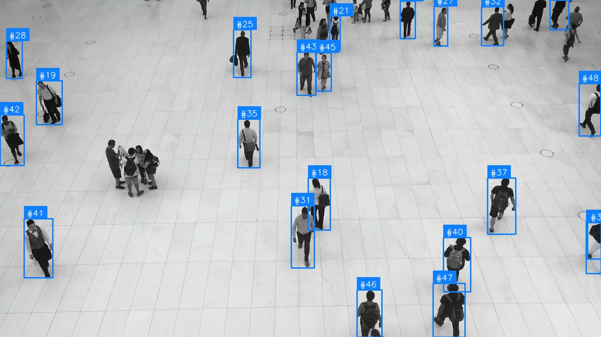

# Track objects across video frames

<!--
summary: Give each object the same id in every frame of a video with pf.tracker: ByteTrack, SORT, OC-SORT, BoT-SORT and C-BIoU.
label: Trackers
keywords: pixelflow, object tracking, multi-object tracking, bytetrack, tracker id, botsort
-->

A detection model looks at each frame on its own: it finds 22 people in one frame and 22 in the
next, but cannot tell which person is which. A tracker matches each frame's detections to the
objects it already follows and gives every object a `tracker_id` that stays the same from frame
to frame. Counting people who cross a line, timing how long someone stays or drawing a path all
start here.

```python
import pixelflow as pf
from mayaku import from_pretrained

predictor = from_pretrained("mayaku-n-det")
person = predictor.class_names.index("Person")

video = pf.VideoReader("crowd.mp4")
tracker = pf.tracker.ByteTrack(frame_rate=video.fps)
ids = set()

with pf.VideoWriter("crowd-tracked.mp4", like=video) as writer:
    for frame in video:
        result = predictor(frame[:, :, ::-1], conf=0.1)  # Mayaku reads arrays as BGR
        detections = pf.from_mayaku(result, labels=predictor.class_names)
        people = detections.filter_by_class_id(person)

        people = tracker.update(people)
        tracked = people.filter_tracked_objects()
        ids.update(d.tracker_id for d in tracked)

        frame = pf.annotate.box(frame, tracked)
        frame = pf.annotate.label(frame, tracked, "#{tracker_id}")
        writer.write(frame)

print(f"{len(tracked)} people tracked in the last frame, {len(ids)} ids in all")
```

```text
22 people tracked in the last frame, 48 ids in all
```



The image is the last of the 341 frames: person #18 has kept the same id since frame 5. The four
people standing together on the left have none: the model gives them a confidence of 0.4 at most,
below what it takes to start a track.

`tracker.update` returns the frame's detections as a copy, in the same order, with a `tracker_id`
on each one that belongs to a track; the input is left unchanged, so write
`people = tracker.update(people)`. [`filter_tracked_objects()`](/docs/core-concepts/filters.md#tracked-objects)
keeps the tracked ones, and the [label template](/docs/visualization/label.md) `"#{tracker_id}"`
writes each id. Pass the video's frame rate: `None`, when a video does not report one, counts as
30 fps.

## Tracker ids

- **`None` until a track is confirmed.** A new object needs a confident detection (see
  [confidence thresholds](#confidence-thresholds)) and a second frame where it is found again:
  on `crowd.mp4`, ByteTrack's first ids appear on the second frame. BoT-SORT and C-BIoU give the
  objects of the very first frame an id at once, and OC-SORT gives ids on a track's first match
  during the first frames of a video.
- **Ids start at 1** and only go up: an id is never given to another object, even after its
  object leaves.
- **A hidden object keeps its id** if it is found again within `lost_track_buffer` frames,
  counted at 30 fps: 30 by default, one second at any frame rate. After that it comes back with a
  new id.
- **`tracker.tracked_objects`** lists every confirmed track that is still alive, with the box the
  tracker estimates for it, including objects hidden in this frame. Those detections have only
  `bbox` and `tracker_id`.
- **`tracker.reset()`** forgets every track and starts the ids at 1 again: call it between two
  videos.

Every detection needs a box. A detection without a confidence counts as fully confident.

## Choose a tracker

PixelFlow has five trackers, all with the same `update`:

| Tracker | How it matches | Use it for |
|---------|----------------|------------|
| `pf.tracker.ByteTrack` | confident detections first, then low-confidence ones to keep tracks through occlusions | most videos: start here |
| `pf.tracker.SORT` | one pass on box overlap | the simplest baseline |
| `pf.tracker.OCSORT` | uses an object's last seen box and direction to pick up a track after an occlusion | objects that are often hidden or change direction |
| `pf.tracker.BoTSORT` | like ByteTrack, and corrects for camera motion when you pass the frame | a [moving or shaking camera](/docs/tracking/tracker-moving-camera.md) |
| `pf.tracker.CBIoU` | enlarges boxes before comparing them | fast or jerky motion, where boxes barely overlap from frame to frame |

`update` takes about 1 ms a frame with any of them (0.78 to 1.25 ms for the 45 people a frame of
the example, on the CPU of an Apple M1 Max), far less than the model. They differ in what they
track: on `crowd.mp4`, SORT gives 164 ids where ByteTrack gives 48, because it starts tracks from
detections of 0.25 and up, and so also follows the low-confidence boxes the others leave alone.

The five trackers are ported from [roboflow/trackers](https://github.com/roboflow/trackers)
(Apache-2.0); its README compares their accuracy on MOT17, SportsMOT, SoccerNet and DanceTrack.

## Confidence thresholds

ByteTrack sorts detections by confidence. Those of `high_conf_det_threshold` (0.6) or more are
matched first; the others only extend tracks that already exist, which keeps a person tracked when
the model is briefly unsure, for example while they pass behind someone. A new track needs a
detection above both thresholds: 0.7 by default.

So feed ByteTrack the low-confidence detections too: the example keeps everything from 0.1, the
lower limit of the original ByteTrack. To track more of the uncertain objects, lower both
thresholds:

```python
tracker = pf.tracker.ByteTrack(frame_rate=video.fps, track_activation_threshold=0.5, high_conf_det_threshold=0.5)
```

On `crowd.mp4`:

| Thresholds | People tracked per frame | People found at 0.5+ who get an id | Ids in all |
|------------|--------------------------|-------------------------------------|------------|
| 0.7 and 0.6 (default) | 22.2 | 83% | 48 |
| 0.5 and 0.5 | 32.4 | 99% | 73 |

More people get an id, but more of the ids are short tracks on uncertain detections.

## Frames that do not come at a steady rate

A camera or a stream can drop frames. Pass each frame's time in seconds, and the tracker predicts
how far objects moved in the time that really passed. For a live camera, the time the frame
arrived:

```python
import time

people = tracker.update(people, timestamp=time.monotonic())
```

`lost_track_buffer` is then counted in seconds. Times must not go back: a frame older than the
previous one is skipped with a warning, and all its detections come back with `tracker_id = None`.

## Parameters

`pf.tracker.ByteTrack(...)`:

| Parameter | Default | |
|-----------|---------|---|
| `lost_track_buffer` | `30` | frames a lost object keeps its track |
| `frame_rate` | `30.0` | the video's frame rate |
| `track_activation_threshold` | `0.7` | confidence a detection needs to start a track |
| `minimum_consecutive_frames` | `2` | frames a new track needs before it gets an id |
| `minimum_iou_threshold` | `0.1` | box overlap (IoU) needed to match a detection to a track |
| `high_conf_det_threshold` | `0.6` | confidence that splits detections into the first and second pass |

The other trackers share `lost_track_buffer`, `frame_rate` and `minimum_consecutive_frames`
(3 for SORT and OC-SORT); `help(pf.tracker.OCSORT)` and so on lists the rest. BoT-SORT's camera
options are on [track objects with a moving camera](/docs/tracking/tracker-moving-camera.md).
