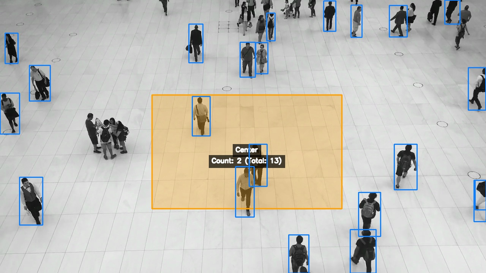

# Count objects in a zone

<!--
summary: Count the objects inside an area of a video, and how many have entered it, with pf.Zones and a tracker.
label: Zones
keywords: pixelflow, zone counting, polygon zone, region of interest, people counting
-->

A zone is an area of the image, such as a doorway, a lane or a shelf. `pf.Zones` tells you, on
every frame, how many objects are inside each zone, and with a [tracker](/docs/tracking/tracker.md),
how many different objects have entered it so far.

```python
import pixelflow as pf
from mayaku import from_pretrained

predictor = from_pretrained("mayaku-n-det")
person = predictor.class_names.index("Person")

video = pf.VideoReader("crowd.mp4")
tracker = pf.tracker.ByteTrack(frame_rate=video.fps)
zones = pf.Zones()
center = zones.add_zone(
    [(400, 250), (900, 250), (900, 550), (400, 550)],
    name="Center", color=(255, 160, 0), trigger_strategy="bottom_center",
)

with pf.VideoWriter("crowd-zone.mp4", like=video) as writer:
    for frame in video:
        result = predictor(frame[:, :, ::-1], conf=0.1)  # Mayaku reads arrays as BGR
        detections = pf.from_mayaku(result, labels=predictor.class_names)
        people = tracker.update(detections.filter_by_class_id(person)).filter_tracked_objects()
        zones.update(people)

        frame = pf.annotate.zones(frame, zones)
        frame = pf.annotate.box(frame, people)
        writer.write(frame)

print(f"{center.current_count} people in the zone now, {center.total_entered} entered in all")
```

```text
2 people in the zone now, 13 entered in all
```



A zone is a polygon: a list of `(x, y)` points in pixels, in order around the area, with as many
points as its shape needs. `add_zone` returns the zone, so you can read its counts later;
[`pf.annotate.zones`](/docs/visualization/zones.md) draws it with its counts, in its `color`
(without one, each zone gets its own).

## Inside or outside

Whether an object is in a zone is decided from its box, by the zone's `trigger_strategy`. The
default, `"center"`, tests the middle of the box. The example tests `"bottom_center"`, where a
person's feet touch the floor: in this video seen from above, that is where people stand. In the
last frame, the person at the bottom edge of the zone is outside, because their feet are below it.

| `trigger_strategy` | An object is inside when |
|--------------------|--------------------------|
| `"center"`, `"bottom_center"`, `"top_center"`, `"left_center"`, `"right_center"` | that point of its box is inside (see [anchors](/docs/visualization/anchors.md)) |
| `"top_left"`, `"top_right"`, `"bottom_left"`, `"bottom_right"` | that corner is inside |
| `"any_corner"`, `"all_corners"` | one corner, or all four, are inside |
| `"overlap"` | its box touches the zone at all |
| `"contains"` | its whole box is inside |
| `"percentage"` | at least `overlap_threshold` (half by default) of its box is inside |

The choice changes the counts. Over the video above, this many people entered the zone:

| `trigger_strategy` | `"contains"` | `"bottom_center"` | `"center"` | `"percentage"` | `"overlap"` |
|--------------------|--------------|-------------------|------------|----------------|-------------|
| Entered | 12 | 13 | 14 | 14 | 16 |

A list of strategies combines them: with `mode="all"` (the default) an object is inside when all
of them say so, with `mode="any"` when one does. `zones.update(people, strategy="overlap")`
replaces every zone's own strategy for that call.

## Two counts

- **`current_count`**: the objects inside on the last `update`. It is counted again on every
  frame, from every detection passed, tracked or not.
- **`total_entered`**: how many different objects have been inside since the start. It counts
  tracker ids, so it needs a tracker: an object that leaves and comes back with the same id
  counts once. Detections without an id never add to it.

`zones.get_zone_counts()` returns every zone's `current_count` by zone id, and
`zones.get_zone_stats()` both counts with each zone's name. `zones.reset_all_counts()` starts
them again from zero.

## Which zone each object is in

`zones.update` writes, on each detection it is passed, the ids and names of the zones it is in:

```python
for detection in people:
    print(detection.tracker_id, detection.zones, detection.zone_names)
```

It changes those detections in place and also returns them. Zones are numbered from 0 unless you
pass a `zone_id` (a number or a name) to `add_zone`. To keep only the objects in some zones:

```python
inside = zones.filter_by_zones(people, [center.zone_id])
outside = zones.filter_by_zones(people, [center.zone_id], exclude=True)
```

## Parameters

`zones.add_zone(...)`:

| Parameter | Default | |
|-----------|---------|---|
| `polygon` | | the zone's corners, as `(x, y)` points in pixels |
| `zone_id` | the next free number | a number or a name to find the zone by |
| `name` | `"Zone <id>"` | the name drawn on the zone |
| `color` | | RGB color to draw the zone in |
| `trigger_strategy` | `"center"` | how an object counts as inside, or a list of ways |
| `overlap_threshold` | `0.5` | share of the box inside the zone, for `"percentage"` |
| `mode` | `"all"` | with a list of strategies: `"all"` must hold, or `"any"` |
| `metadata` | `{}` | anything you want to keep with the zone |
