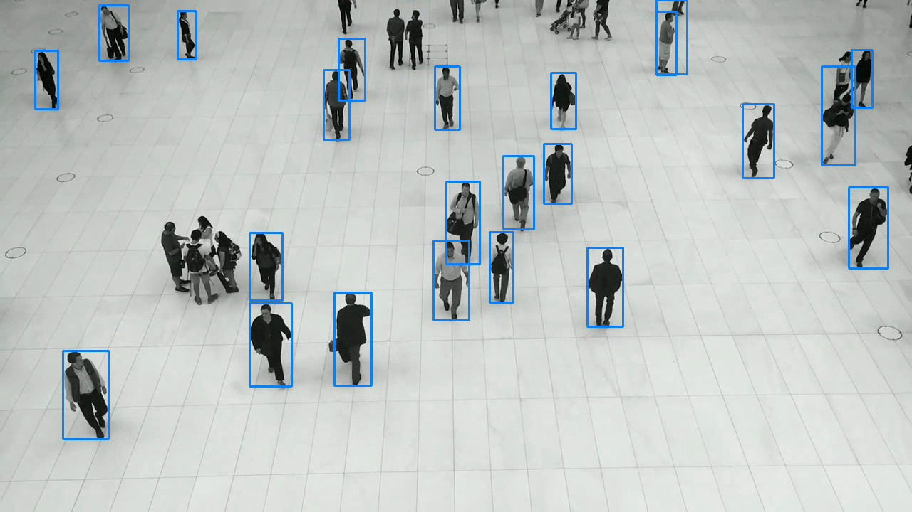

# Look at past and future frames with a buffer

<!--
summary: Hold the last few frames of a video with their results, so each frame can be processed knowing the frames before and after it, with pf.Buffer.
label: Buffer
keywords: pixelflow, frame buffer, temporal context, video delay, moving average
-->

Some decisions about a frame are easier with the frames around it: a count that jumps from one
frame to the next, a detection that appears for a single frame. `pf.Buffer` keeps the last few
frames with their results and hands each one back a few frames late, once the frames after it
have arrived. For that frame, you have both the frames before it and the frames after it.

```python
import pixelflow as pf
from mayaku import from_pretrained

predictor = from_pretrained("mayaku-n-det")
person = predictor.class_names.index("Person")
buffer = pf.Buffer(frames=5)
counts = []


def process(people, frame):
    context = buffer.get_temporal_context()
    window = context["past_results"] + [people] + context["future_results"]
    counts.append((len(people), sum(len(d) for d in window) / len(window)))
    writer.write(pf.annotate.box(frame, people))


video = pf.VideoReader("crowd.mp4")
with pf.VideoWriter("crowd-buffered.mp4", like=video) as writer:
    for frame in video:
        result = predictor(frame[:, :, ::-1])  # Mayaku reads arrays as BGR
        detections = pf.from_mayaku(result, labels=predictor.class_names)
        people = detections.filter_by_confidence(0.5).filter_by_class_id(person)

        people, frame = buffer.update(people, frame)
        if frame is not None:
            process(people, frame)

    for people, frame in buffer.flush():
        process(people, frame)

print(writer.frames_written)
for index in (0, 100, 200, 340):
    count, average = counts[index]
    print(f"frame {index}: {count} people, {average:.1f} on average")
```

```text
341
frame 0: 24 people, 23.7 on average
frame 100: 29 people, 28.8 on average
frame 200: 26 people, 26.2 on average
frame 340: 21 people, 21.6 on average
```



`buffer.update(results, frame)` stores the new frame and its results, and returns a frame and
its results from earlier: with `frames=5`, the ones from 2 frames ago. They always belong
together, so the boxes you draw are the right ones for the frame you draw on.

`get_temporal_context()` returns the buffer around that frame. Above, the count of each frame is
averaged with the 2 frames before it and the 2 after. Because the window is centered on the
frame, the average does not lag behind the crowd, as an average of past frames only would.

## The first and last frames

For the first 2 calls, nothing is ready: frame 0 needs frames 1 and 2 after it. `update` returns
`(None, None)`, hence `if frame is not None`. From the third call on, it returns frames 0, 1,
2 and so on, in order.

When the video ends, the last 2 frames are still in the buffer, waiting for frames that will
not come. `flush()` returns them. With both, every frame comes out once: above, 341 frames in,
341 out.

Near the start, a frame has fewer frames before it, and near the end, fewer after it: frame 0
is averaged over 3 frames, not 5. If your processing needs the full window, check the length
of `past_results` and `future_results`. `pf.smooth` does this: it smooths only frames with a
full window, and returns the others as they are.

`buffer.delay` is how many frames late the output is: `frames // 2`. A larger buffer gives more
context and a longer delay. Use an odd number of frames, so the frame in the middle has the same
number of frames on each side.

## The context

`get_temporal_context()` describes the frame `update` or `flush` returned last. It returns
`None` before the first one, then a dictionary:

| Key | |
|-----|---|
| `past_frames`, `past_results` | lists of the frames and results before it, oldest first |
| `current_frame`, `current_results` | the frame and results `update` or `flush` returned |
| `future_frames`, `future_results` | lists of the frames and results after it, oldest first |

The results can be anything you pass to `update`: `Detections`, a count or a dictionary of your
own.

`get_buffer_contents()` returns `(results, frames)` as two lists, oldest first. `reset()` empties
the buffer. Calling `update` after `flush()` starts again with an empty buffer, so the frames of
the next video do not mix with the last one.

## Parameters

`pf.Buffer(frames=5)`:

| Parameter | Default | |
|-----------|---------|---|
| `frames` | `5` | number of frames to keep, from 1 to 1000; an even number gives a warning |

| Attribute | |
|-----------|---|
| `delay` | how many frames late `update` returns: `frames // 2` |
| `is_full` | whether the buffer holds `frames` frames |
| `frames_processed` | number of `update` calls since the start or the last `reset()` |
| `current_size` | number of frames in the buffer now |

Every frame is copied when it enters the buffer: 5 frames of 1280×720 use 14 MB.
