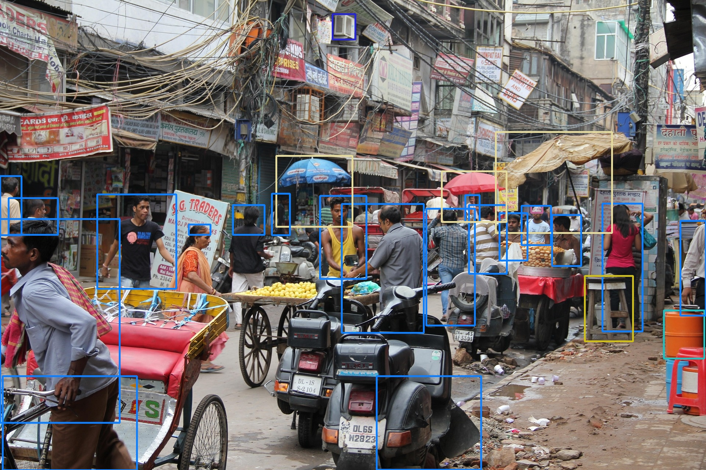

# Detect small objects in large images

<!--
summary: Find small objects a model misses in a large image by running it on overlapping slices and merging the results, with SlicedInference.
label: Sliced inference
keywords: pixelflow, sliced inference, small object detection, tiling, large images
-->

A detection model shrinks every image to its input size before it looks at it. In a large
photo, a person at the back of the scene becomes a few pixels and is missed. `SlicedInference`
cuts the image into overlapping slices, runs the model on each one at full resolution, and
merges the results into one `Detections` for the whole image.

```python
import pixelflow as pf
from mayaku import from_pretrained

predictor = from_pretrained("mayaku-n-det")


def detect(tile):
    result = predictor(tile[:, :, ::-1])  # Mayaku reads arrays as BGR
    detections = pf.from_mayaku(result, labels=predictor.class_names)
    return detections.filter_by_confidence(0.5)


image = pf.read_image("street.jpg")
slicer = pf.SlicedInference(slice_width=640, slice_height=640)
detections = slicer.predict(image, detect)

print(len(detect(image)), len(detections))

image = pf.annotate.box(image, detections)
pf.save_image("street-sliced.jpg", image)
```

```text
11 26
```



`predict` takes the image and a function that turns one slice into `Detections`. It calls that
function once per slice, here 12 times for 4 columns and 3 rows, and moves each detection from
slice to image coordinates: its box, and its mask, outline and keypoints if it has them. A mask
is placed on an image-sized canvas, so with a segmentation model such as `mayaku-n-seg`,
[`pf.annotate.mask`](/docs/visualization/mask.md) draws the result on the whole image.

On the whole 1920×1280 image, the model finds 11 objects with a confidence of 0.5 or more,
8 of them people. On the slices it finds 26, 19 of them people, most at the back of the street.

## What slicing costs

The model runs once per slice. Above, on the GPU of an Apple M1 Max, the 12 slices took 345 ms
and one pass on the whole image 35 ms.

Large objects suffer. An object that crosses the edge of a slice is seen in pieces: in the
image above, the man in the front gets two partial boxes, and the two motorcycles found on the
whole image are not found at all, since no slice holds enough of either. A piece can also be
mistaken for something else: the box at the bottom, labelled a person, is the back of a
scooter. Use slicing
when the objects you want are small compared to the image, such as people in a wide view,
vehicles in an aerial photo or defects on a large scan.

The function must return `Detections`: convert the model's output inside it, as above.
Anything else raises a `TypeError`.

## Slice size and overlap

Make slices about the size the model works at: 640 pixels for most models. Smaller slices find
smaller objects but take more runs and cut more objects.

Slices overlap by 20% of their size by default, so an object on the edge of one slice is whole
in the next. Raise `overlap_ratio_w` and `overlap_ratio_h` when objects are cut too often; it
also adds slices.

`pf.auto_slice_size(height, width)` gives a slice size with the image's shape: for a
1920×1280 image, 426 pixels high and 640 wide, which makes 16 slices.

```python
slice_height, slice_width = pf.auto_slice_size(*image.shape[:2])
slicer = pf.SlicedInference(slice_height=slice_height, slice_width=slice_width)
```

## How duplicates are merged

An object inside an overlap is found twice, once in each slice. `predict` keeps one, going
from the highest confidence down, and compares only boxes of the same class:

- boxes from neighbouring slices overlapping with an IoU above 0.7 × `iou_threshold`
  (0.35 by default) are the same object;
- other boxes are the same object above `iou_threshold`;
- a box that lies more than `ios_threshold` (90% by default) inside another box of the same
  class is removed.

IoU is the area two boxes share divided by the area they cover together. With
`merge_mode="nmm"`, duplicates from neighbouring slices are replaced by their average box,
weighted by confidence, instead of keeping only the best one.

## Parameters

`pf.SlicedInference(...)`:

| Parameter | Default | |
|-----------|---------|---|
| `slice_height` | `640` | slice height in pixels |
| `slice_width` | `640` | slice width in pixels |
| `overlap_ratio_h` | `0.2` | vertical overlap between slices, from 0 to 0.9 |
| `overlap_ratio_w` | `0.2` | horizontal overlap between slices, from 0 to 0.9 |
| `iou_threshold` | `0.5` | IoU above which two boxes are the same object |
| `ios_threshold` | `0.9` | share of a box inside another above which it is removed |
| `merge_mode` | `"nms"` | `"nms"` keeps the best box, `"nmm"` averages duplicates |

`slicer.predict(image, detector_func, verbose=False, **detector_kwargs)`:

| Parameter | Default | |
|-----------|---------|---|
| `image` | | RGB image |
| `detector_func` | | function that takes a slice (an RGB array) and returns `Detections` |
| `verbose` | `False` | print the number of detections per slice |
| `**detector_kwargs` | | passed on to `detector_func` |
