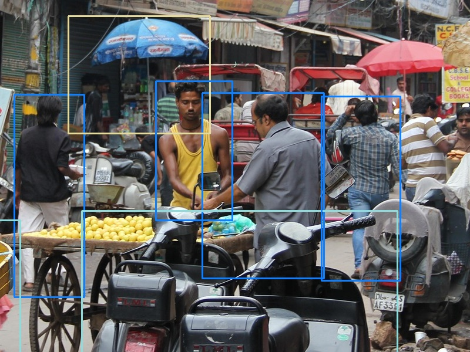
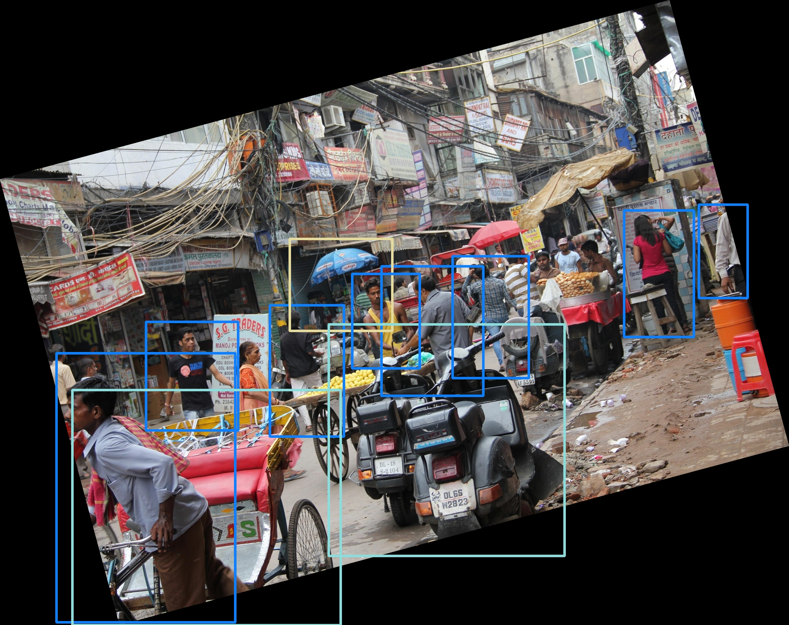

# Resize, crop, rotate and flip images and detections

<!--
summary: Resize, crop, rotate, flip and adjust the contrast of images, and move detections along with the image so they stay aligned, with pf.transform.
label: Transforms
keywords: pixelflow, image transforms, crop detections, rotate image, resize, contrast
-->

`pf.transform` changes images: their size, their framing, their orientation or their contrast.
When you have detections for an image, the `_detections` versions change the image and move the
detections with it, so the boxes still cover the same objects.

```python
import pixelflow as pf
from mayaku import from_pretrained

predictor = from_pretrained("mayaku-n-det")
result = predictor("street.jpg")
detections = pf.from_mayaku(result, labels=predictor.class_names)
detections = detections.filter_by_confidence(0.5)

image = pf.read_image("street.jpg")
crop, inside = pf.transform.crop_detections(image, detections, [600, 400, 1400, 1000])

crop = pf.annotate.box(crop, inside)
pf.save_image("street-crop.jpg", crop)
```



The crop is the area from (600, 400) to (1400, 1000). Of the 11 detections, `crop_detections`
keeps the 7 whose box touches it, with coordinates measured from the crop's top-left corner.
Boxes are not cut at the edge of the crop: a box that crosses it keeps its full size, partly
outside the image, such as the motorcycle on the left, from x = −600 to 34.

## Resize

```python
small = pf.transform.resize(image, width=640)
```

Give `width` or `height`, not both: the other follows from the image's shape, so a 1920×1280
image becomes 640×427. When the image already has that size, `resize` returns the same array,
not a copy; the annotators draw on the array you give them, so copy it first if you need both.

There is no `resize_detections`. Run the model on the image you will draw on, and resize the
result after drawing.

## Image only

These change the image and nothing else:

| Function | Returns |
|----------|---------|
| `resize(image, width=None, height=None)` | the image scaled to that width or height |
| `crop(image, [x1, y1, x2, y2])` | the area inside the box, cut to the image |
| `rotate(image, angle, center=None, fillcolor=None)` | the image turned `angle` degrees counter-clockwise, made larger so nothing is cut |
| `flip_horizontal(image)`, `flip_vertical(image)` | the mirror image, left to right or top to bottom |
| `clahe(image, clip_limit=2.0, tile_size=(8, 8))` | more local contrast, on the lightness only |
| `auto_contrast(image, cutoff=1.0)` | the darkest `cutoff` % made black and the brightest white, per channel |
| `gamma_correction(image, gamma)` | brighter for `gamma` above 1, darker below 1 |
| `to_grayscale(image, keep_channels=False)` | a grayscale image: one channel, or three equal ones with `keep_channels=True` |
| `normalize(image, mean, std)` | `float32` values scaled to 0–1, minus `mean`, divided by `std`, for a model's input |
| `standardize(image)` | `float32` values with a mean of 0 and a standard deviation of 1 |

`rotate` fills the corners it adds by repeating the pixels at the edge of the image; pass
`fillcolor=(0, 0, 0)` for black instead.

`to_grayscale` without `keep_channels`, `normalize` and `standardize` return arrays the
annotators and `save_image` do not take: use them for model input, not for drawing.

## Move detections with the image

| Function | Returns |
|----------|---------|
| `crop_detections(image, detections, [x1, y1, x2, y2])` | `(image, detections)`: the crop and the detections that touch it |
| `rotate_detections(image, detections, angle, center=None, fillcolor=None)` | `(image, detections)` turned together |
| `flip_horizontal_detections(image, detections)` | `(image, detections)` mirrored left to right |
| `flip_vertical_detections(image, detections)` | `(image, detections)` mirrored top to bottom |
| `rotate_to_align(image, detections, point1_name, point2_name, target_angle=0.0, detection_index=0)` | `(image, detections)` turned so the line between two keypoints of one detection is at `target_angle` |

They move boxes, masks, outlines and keypoints. Each returns new detections; the ones you pass
in do not change.

```python
image = pf.read_image("street.jpg")
image, detections = pf.transform.rotate_detections(image, detections, angle=15, fillcolor=(0, 0, 0))

image = pf.annotate.box(image, detections)
pf.save_image("street-rotated.jpg", image)
```



A box stays upright: after a rotation, it becomes the smallest upright box around the turned
one, so it is larger than the object. Masks and keypoints follow the object exactly.

`crop_detections` drops keypoints that fall outside the crop, so the keypoint list of a person
cut by the crop is shorter.

## Crop around each detection

`crop_around_detections` returns one image per detection, the area of its box, for example to
save each person or to pass each object to a second model:

```python
crops = pf.transform.crop_around_detections(image, detections, padding=0.2)
for index, crop in enumerate(crops):
    pf.save_image(f"object-{index}.jpg", crop)
```

`padding=0.2` adds 20% of the box's shorter side on every side. Pass a dictionary for different
sides: `{"left": 0.2, "right": 0.2, "top": 0.1, "bottom": 0}`, as fractions of the box's width
(left and right) and height (top and bottom). Crops stop at the edge of the image.

To make the boxes themselves larger, `add_padding(detections, 0.1)` returns detections with
every box grown by 10% of its shorter side. Set `reference` to `"longer"`, `"width"` or
`"height"` to measure from another side. A padded box can extend past the image.

`update_bbox_from_keypoints(detections, keypoint_names=None)` replaces each box with the
smallest box around the detection's keypoints, or only the named ones.

## Undo transforms

Each transform records itself in `detection.metadata["transforms"]`. `inverse_transforms` reads
that list and undoes it, last transform first, to bring detections back to the coordinates of
the original image:

```python
crop, inside = pf.transform.crop_detections(image, detections, [600, 400, 1400, 1000])
original = pf.transform.inverse_transforms(inside)
```

It works on detections that went through the transforms, not on new results from a model you
run on the transformed image: those have no history.

In this version, `inverse_transforms` undoes crops and flips exactly, but not rotations or
`add_padding`: a rotated box comes back in the wrong place, and a padded box comes back
smaller than it was before padding. Keep the detections from before those transforms instead. A
cropped mask stays the size of the crop.
