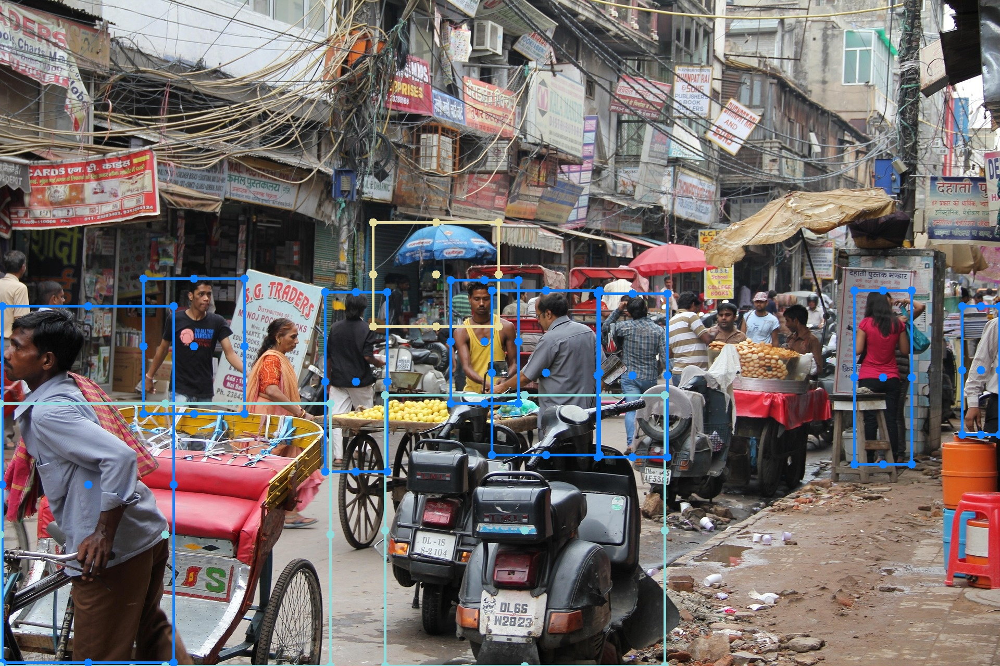

# Anchors

<!--
summary: Draw dots at the corners, center or edge midpoints of each box with pf.annotate.anchors, to see the points zones and line crossings test.
label: Anchors
keywords: pixelflow, anchor points, bounding box center, bottom center, annotate anchors
-->

An anchor is a point on a box: its center, a corner or the middle of an edge.
[Zones](/docs/tracking/zones.md) and [line crossings](/docs/tracking/crossings.md) decide where
an object is from its anchor, often `"bottom_center"`, where it touches the ground.
`pf.annotate.anchors` draws these points, so you can see which point is being tested.

```python
import pixelflow as pf
from mayaku import from_pretrained

predictor = from_pretrained("mayaku-n-det")
result = predictor("street.jpg")
detections = pf.from_mayaku(result, labels=predictor.class_names)
detections = detections.filter_by_confidence(0.5)

image = pf.read_image("street.jpg")
image = pf.annotate.box(image, detections)
image = pf.annotate.anchors(image, detections)
pf.save_image("street-anchors.jpg", image)
```



Without `strategy`, every box gets all nine points. Name one or more to draw only those:

```python
image = pf.annotate.anchors(image, detections, strategy="bottom_center")
image = pf.annotate.anchors(image, detections, strategy=["center", "bottom_center"])
```

| `strategy` | Point |
|------------|-------|
| `"center"` | the middle of the box |
| `"top_left"`, `"top_right"`, `"bottom_left"`, `"bottom_right"` | a corner |
| `"top_center"`, `"bottom_center"`, `"left_center"`, `"right_center"` | the middle of an edge |

## Parameters

| Parameter | Default | |
|-----------|---------|---|
| `image` | | RGB image, drawn on in place |
| `detections` | | the `Detections` to mark |
| `strategy` | `None` (all nine) | one point name, or a list of them |
| `radius` | from the image size | dot radius in pixels: 8 on a 1920×1280 image |
| `thickness` | `-1` | `-1` fills the dot; a positive number draws a ring that many pixels wide |
| `colors` | the default palette | list of RGB colors, picked by `class_id` (see [colors](/docs/visualization/overview.md#colors-follow-the-class)) |
