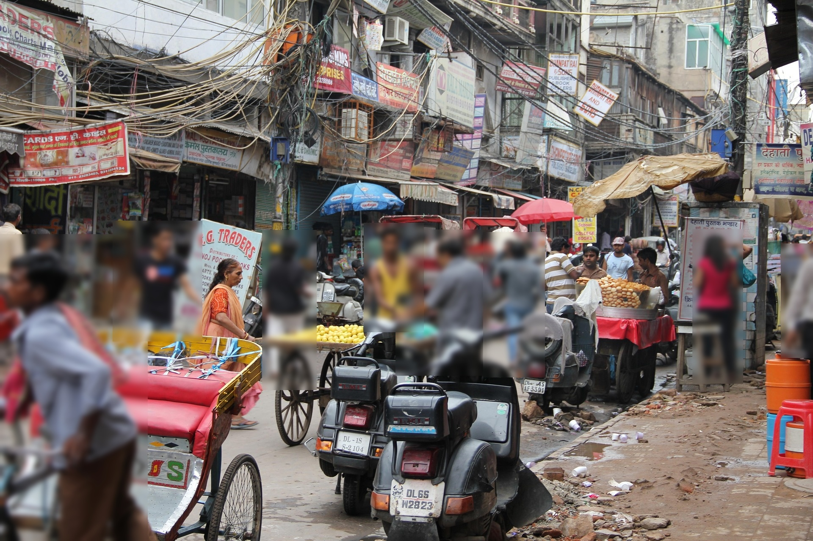

# Blur

<!--
summary: Blur people, faces or license plates inside their boxes with pf.annotate.blur, to hide identities before an image is shared.
label: Blur
keywords: pixelflow, blur faces, anonymize, privacy, annotate blur
-->

Before images of people leave your system, you often have to hide who is in them.
`pf.annotate.blur` blurs the inside of each box and leaves the rest of the image sharp.

```python
import pixelflow as pf
from mayaku import from_pretrained

predictor = from_pretrained("mayaku-n-det")
result = predictor("street.jpg")
detections = pf.from_mayaku(result, labels=predictor.class_names)
detections = detections.filter_by_confidence(0.5)

people = detections.filter_by_class_id(predictor.class_names.index("Person"))

image = pf.read_image("street.jpg")
image = pf.annotate.blur(image, people)
pf.save_image("street-blurred.jpg", image)
```



Blur only covers what the model finds: a person it misses, or scores below your threshold, stays
sharp. For privacy, use a lower confidence threshold than you would for counting: an extra blurred
patch costs less than one face left visible.

Each box is grown by `padding_percent` on every side first, so the edges of the person are blurred
too. A box smaller than the blur kernel is left as it is.

To make the hidden area look blocky rather than soft, use [`pixelate`](/docs/visualization/pixelate.md).

## Parameters

| Parameter | Default | |
|-----------|---------|---|
| `image` | | image, changed in place |
| `detections` | | the `Detections` to blur |
| `kernel_size` | from the image size | size of the blur in pixels; larger is stronger. Even numbers are rounded up to odd. 39 on a 1920×1280 image |
| `padding_percent` | `0.05` | how much to grow each box on every side, as a share of its width and height, from 0 to 0.5 |
