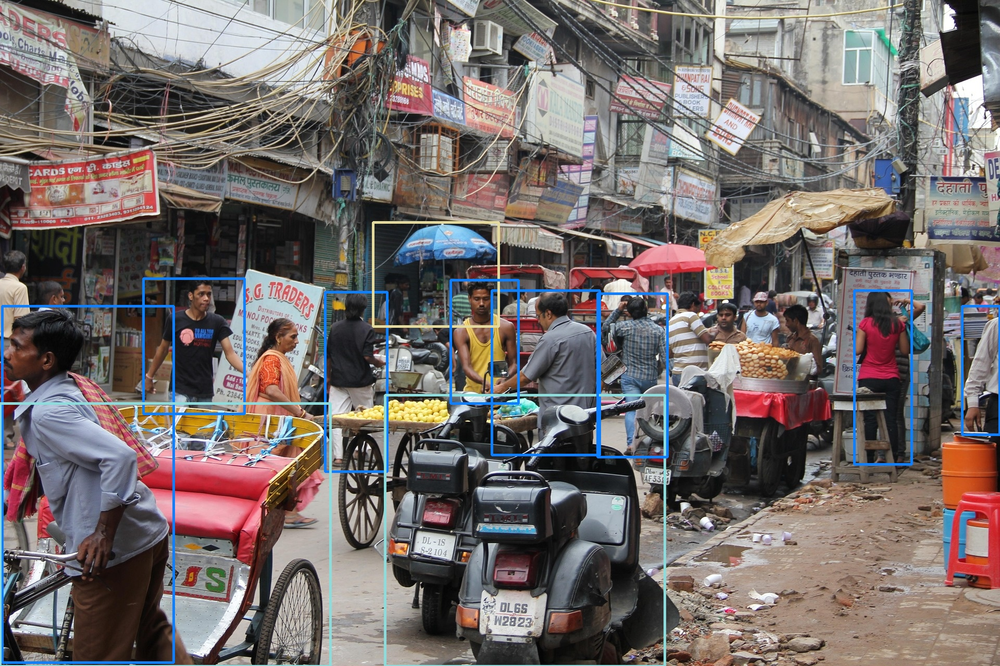

# Box

<!--
summary: Draw the outline of each detection's bounding box, colored by class, with pf.annotate.box.
label: Box
keywords: pixelflow, draw bounding boxes, annotate box, object detection visualization
-->

`pf.annotate.box` draws the outline of each detection's box. It is the quickest way to check what
a model found, and the base most other marks are drawn on.

```python
import pixelflow as pf
from mayaku import from_pretrained

predictor = from_pretrained("mayaku-n-det")
result = predictor("street.jpg")
detections = pf.from_mayaku(result, labels=predictor.class_names)
detections = detections.filter_by_confidence(0.5)

image = pf.read_image("street.jpg")
image = pf.annotate.box(image, detections)
pf.save_image("street-boxes.jpg", image)
```



Boxes show what was found, not what it is: add [labels](/docs/visualization/label.md) for the
class and confidence.

## Parameters

| Parameter | Default | |
|-----------|---------|---|
| `image` | | RGB image, drawn on in place |
| `detections` | | the `Detections` to draw |
| `thickness` | from the image size | line width in pixels: 4 on a 1920×1280 image |
| `colors` | the default palette | list of RGB colors, picked by `class_id` (see [colors](/docs/visualization/overview.md#colors-follow-the-class)) |
