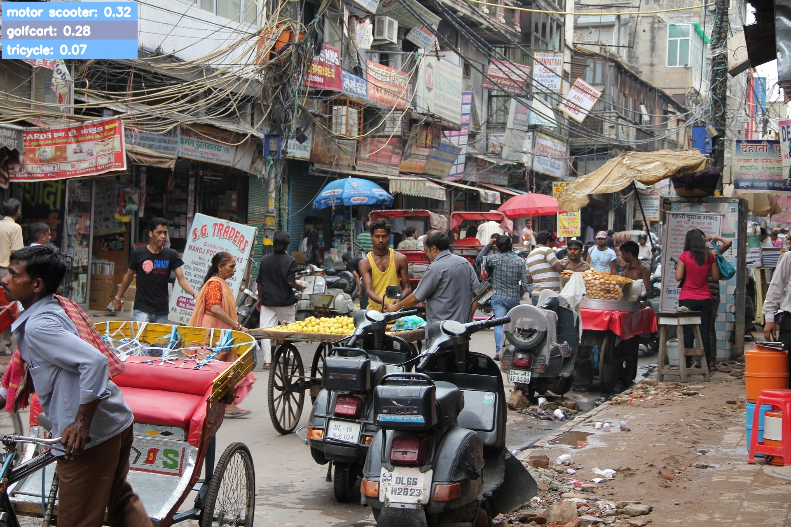

# Classification

<!--
summary: Write an image classifier's top classes and scores in a corner of the image with pf.annotate.classification.
label: Classification
keywords: pixelflow, image classification, top-k, draw class scores, annotate classification
-->

A classifier names what the whole image shows, without boxes, so there is nothing to draw on.
`pf.annotate.classification` writes its best answers in a corner instead, one row per class.

```python
import torch
import pixelflow as pf
from torchvision.models import resnet18, ResNet18_Weights

weights = ResNet18_Weights.DEFAULT
model = resnet18(weights=weights).eval()
preprocess = weights.transforms()

image = pf.read_image("street.jpg")
batch = preprocess(pf.to_pil(image)).unsqueeze(0)
with torch.no_grad():
    probabilities = model(batch).softmax(dim=-1)[0]
result = pf.from_scores(probabilities, labels=weights.meta["categories"])

image = pf.annotate.classification(image, result, top_k=3)
pf.save_image("street-classes.jpg", image)
```



The rows are the `top_k` best classes, best first, each written as its name and score. Each row
takes the color of its class, as boxes do. See
[classifications](/docs/core-concepts/classifications.md) for where `result` comes from.

## Parameters

| Parameter | Default | |
|-----------|---------|---|
| `image` | | RGB image, drawn on in place |
| `classifications` | | the `Classifications` to write |
| `top_k` | `1` | how many classes to write, best first |
| `position` | `"top_left"` | the corner: `"top_left"`, `"top_right"`, `"bottom_left"` or `"bottom_right"` |
| `font_scale` | from the image size | text size: 0.94 on a 1920×1280 image |
| `text_color` | `(255, 255, 255)` | RGB color of the text |
| `bg_color` | the class color | one RGB color for every row's background |
| `padding` | from the image size | pixels between the text and the edge of its row: 12 on a 1920×1280 image |
