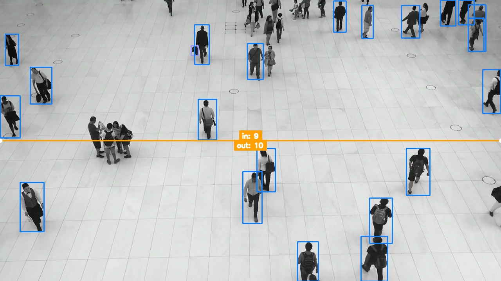

# Crossings

<!--
summary: Draw the counting lines of a Crossings object with their in and out counts on each video frame, with pf.annotate.crossings.
label: Crossings
keywords: pixelflow, line crossing, line counter, in out count, annotate crossings
-->

A crossing is a line that counts the tracked objects passing over it, in each direction.
`pf.annotate.crossings` draws every line of a `pf.Crossings` object with its two counts.

```python
import pixelflow as pf
from mayaku import from_pretrained

predictor = from_pretrained("mayaku-n-det")
tracker = pf.tracker.ByteTrack()
crossings = pf.Crossings()
crossings.add_crossing(start=(0, 360), end=(1280, 360), name="Middle", color=(255, 160, 0))

video = pf.VideoReader("crowd.mp4")
with pf.VideoWriter("crowd-crossings.mp4", like=video) as writer:
    for frame in video:
        result = predictor(frame[:, :, ::-1])  # Mayaku reads arrays as BGR
        detections = pf.from_mayaku(result, labels=predictor.class_names)
        detections = tracker.update(detections.filter_by_confidence(0.5))
        crossings.update(detections)

        frame = pf.annotate.box(frame, detections)
        frame = pf.annotate.crossings(frame, crossings)
        writer.write(frame)
```



The image is the last of the 341 frames: over the video, 9 objects crossed the line one way (8
people and a handbag) and 10 the other.

Each line is drawn with a dot at both ends and its counts in the middle. Draw after
`crossings.update()`, so the counts include the current frame. Counting needs tracker ids, which is
why the loop runs the [tracker](/docs/tracking/tracker.md) first; see
[count objects crossing a line](/docs/tracking/crossings.md) for which way is "in".

Give each line a `color` when you add it: without one, every line is drawn in the same red.

## Parameters

| Parameter | Default | |
|-----------|---------|---|
| `image` | | RGB image, drawn on in place |
| `crossings_manager` | | the `pf.Crossings` to draw |

Line width and text size follow the image size; the text is white on the line's color.
