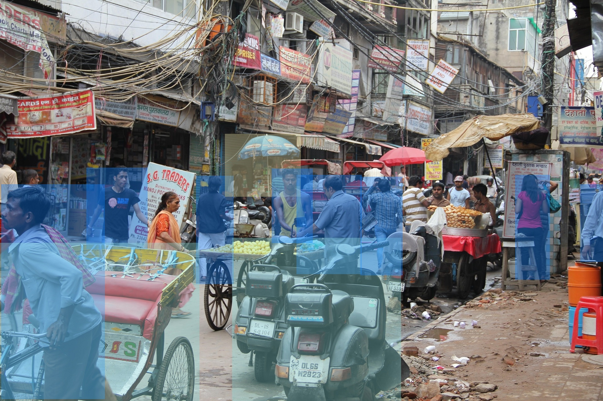

# Filled box

<!--
summary: Fill each detection's bounding box with a see-through color, with pf.annotate.filled_box.
label: Filled box
keywords: pixelflow, filled bounding box, transparent overlay, annotate filled_box
-->

`pf.annotate.filled_box` covers each box with a see-through color. The objects stand out from
the background at a glance, which a thin outline does not do on a busy image.

```python
import pixelflow as pf
from mayaku import from_pretrained

predictor = from_pretrained("mayaku-n-det")
result = predictor("street.jpg")
detections = pf.from_mayaku(result, labels=predictor.class_names)
detections = detections.filter_by_confidence(0.5)

image = pf.read_image("street.jpg")
image = pf.annotate.filled_box(image, detections)
pf.save_image("street-filled.jpg", image)
```



Where boxes overlap, the colors add up and the overlap is darker. Draw filled boxes before
[box outlines](/docs/visualization/box.md) and [labels](/docs/visualization/label.md), so those
stay on top.

## Parameters

| Parameter | Default | |
|-----------|---------|---|
| `image` | | RGB image, drawn on in place |
| `detections` | | the `Detections` to draw |
| `opacity` | from the image size | from 0 (invisible) to 1 (solid): between 0.3 and 0.5, lower on larger images; 0.37 on a 1920×1280 image |
| `colors` | the default palette | list of RGB colors, picked by `class_id` (see [colors](/docs/visualization/overview.md#colors-follow-the-class)) |
