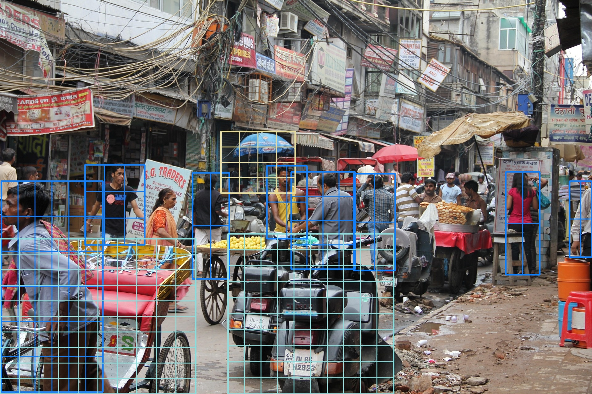

# Grid overlay

<!--
summary: Draw a grid of lines inside each bounding box with pf.annotate.grid_overlay, as a plain grid or a see-through checkerboard.
label: Grid overlay
keywords: pixelflow, grid overlay, checkerboard, bounding box grid, annotate grid_overlay
-->

`pf.annotate.grid_overlay` divides each box into a grid of cells. It draws only the lines inside
the box, not its edge, so it is usually drawn together with [box](/docs/visualization/box.md).

```python
import pixelflow as pf
from mayaku import from_pretrained

predictor = from_pretrained("mayaku-n-det")
result = predictor("street.jpg")
detections = pf.from_mayaku(result, labels=predictor.class_names)
detections = detections.filter_by_confidence(0.5)

image = pf.read_image("street.jpg")
image = pf.annotate.box(image, detections)
image = pf.annotate.grid_overlay(image, detections)
pf.save_image("street-grid.jpg", image)
```



Without `grid_size`, each box gets one row and one column for every 50 pixels of its shorter
side, from 2 to 10. Pass `grid_size=(rows, cols)` to use the same grid for every box.

`filled=True` fills every other cell, as a see-through checkerboard:

```python
image = pf.annotate.grid_overlay(image, detections, grid_size=(4, 4), filled=True)
```

## Parameters

| Parameter | Default | |
|-----------|---------|---|
| `image` | | RGB image, drawn on in place |
| `detections` | | the `Detections` to draw grids in |
| `grid_size` | from each box's size | `(rows, cols)`, at least 2 each |
| `thickness` | from the image size | line width in pixels, half that of [box](/docs/visualization/box.md): 2 on a 1920×1280 image |
| `colors` | the default palette | list of RGB colors, picked by `class_id` (see [colors](/docs/visualization/overview.md#colors-follow-the-class)) |
| `filled` | `False` | fill every other cell |
| `opacity` | `0.25` | fill opacity when `filled=True`, from 0 to 1 |
