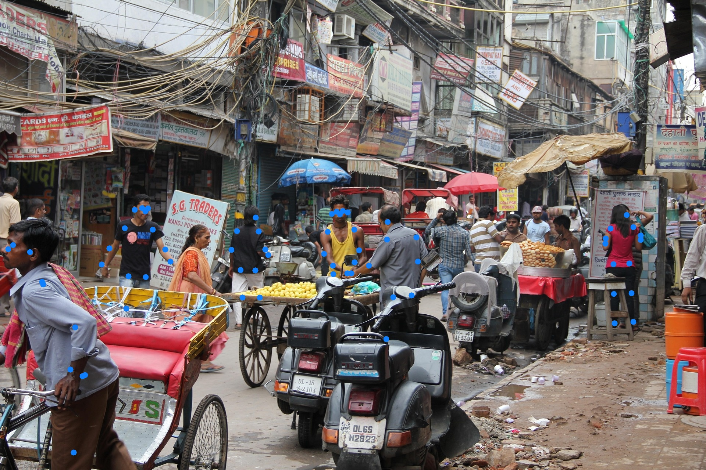

# Keypoint

<!--
summary: Draw a dot on each keypoint of a pose model, such as the joints of a person, with pf.annotate.keypoint and a confidence threshold.
label: Keypoint
keywords: pixelflow, pose estimation, draw keypoints, body joints, annotate keypoint
-->

A pose model finds points on each object: the eyes, shoulders, elbows and knees of a person.
`pf.annotate.keypoint` draws a dot on each one.

```python
import pixelflow as pf
from ultralytics import YOLO

model = YOLO("yolo11n-pose.pt")
detections = pf.from_ultralytics(model("street.jpg"))
detections = detections.filter_by_confidence(0.5)

image = pf.read_image("street.jpg")
image = pf.annotate.keypoint(image, detections, min_confidence=0.5)
pf.save_image("street-keypoints.jpg", image)
```



## Hide the points the model is unsure about

A pose model returns every point for every person, including the ones it cannot see: a knee
behind a cart still gets a position, with a low score. `min_confidence` skips the points that score
lower. The default, `0.0`, draws them all; the right threshold depends on the model, so try a few
values on your own images. Above, the ankles of the people standing behind the carts score
between 0.04 and 0.17, and `0.5` hides them.

## Show the names

`show_names=True` writes each point's name next to it. Names come from the `labels` you give the
converter; points without a name are drawn without text. The
[skeleton page](/docs/visualization/keypoint-skeleton.md) shows how to name the 17 body points.

To join the points into a stick figure, draw a
[skeleton](/docs/visualization/keypoint-skeleton.md) first, then the points on top.

## Parameters

| Parameter | Default | |
|-----------|---------|---|
| `image` | | RGB image, drawn on in place |
| `detections` | | the `Detections` whose keypoints to draw |
| `radius` | from the image size | dot radius in pixels: 8 on a 1920×1280 image |
| `thickness` | `-1` | `-1` fills the dot; a positive number draws a ring that many pixels wide |
| `colors` | the default palette | list of RGB colors, picked by `class_id` (see [colors](/docs/visualization/overview.md#colors-follow-the-class)) |
| `show_names` | `False` | write each point's name next to it |
| `min_confidence` | `0.0` | skip points scoring lower than this |
