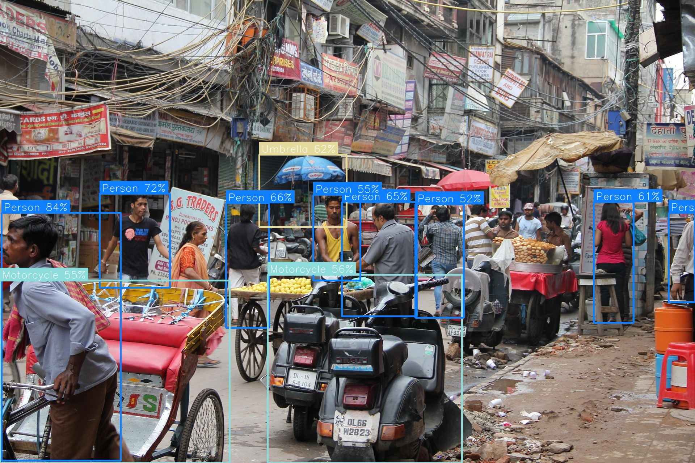

# Label

<!--
summary: Write each detection's class, confidence, tracker id or any text next to its box, with pf.annotate.label and format templates.
label: Label
keywords: pixelflow, draw labels, class name, confidence, annotate label, text template
-->

`pf.annotate.label` writes text on a colored background next to each box. Without other
arguments it writes the class name and the confidence, such as `Person: 0.84`.

```python
import pixelflow as pf
from mayaku import from_pretrained

predictor = from_pretrained("mayaku-n-det")
result = predictor("street.jpg")
detections = pf.from_mayaku(result, labels=predictor.class_names)
detections = detections.filter_by_confidence(0.5)

image = pf.read_image("street.jpg")
image = pf.annotate.box(image, detections)
image = pf.annotate.label(image, detections, "{class_name} {confidence:.0%}")
pf.save_image("street-labels.jpg", image)
```



## Choose the text

The third argument, `texts`, sets what each label says:

| `texts` | Each label says |
|---------|-----------------|
| `None` (default) | the detection's `text` if it has one (OCR, captions), else its `class_name`, then its confidence: `Person: 0.84` |
| a template string | the template filled with each detection's fields |
| a list of strings | the string at the same position: one per detection |

A template is a Python format string. It can use `{class_name}`, `{confidence}`, `{class_id}`,
`{tracker_id}`, `{text}` and `{bbox}`, with the usual format options: `{confidence:.0%}` gives
`84%`. A field the detection does not have prints as `None`.

Add `\n` for a label on several lines, for example with the tracker id from a
[video](/docs/tracking/tracker.md):

```python
image = pf.annotate.label(image, detections, "#{tracker_id}\n{class_name}")
```

## Where labels go

`position` places the label against the box: `"top_left"` (default), `"top_center"`,
`"top_right"`, `"center_left"`, `"center"`, `"center_right"`, `"bottom_left"`, `"bottom_center"`
or `"bottom_right"`. Top labels sit just above the box and bottom labels just below it.

Labels are not moved to stay inside the image: a top label on a box that touches the top edge is
cut off. Use a center or bottom position for objects that fill the frame.

## Parameters

| Parameter | Default | |
|-----------|---------|---|
| `image` | | RGB image, drawn on in place |
| `detections` | | the `Detections` to label |
| `texts` | `None` | what each label says (see above) |
| `position` | `"top_left"` | where the label goes against the box |
| `font_scale` | from the image size | text size: 0.94 on a 1920×1280 image |
| `padding` | `6` | pixels between the text and the edge of its background |
| `line_spacing` | `2` | extra pixels between lines |
| `bg_color` | the class color | one RGB color for every label's background |
| `text_color` | `(255, 255, 255)` | RGB color of the text |

The background takes the same color as the detection's [box](/docs/visualization/box.md) with the
default palette. `label` has no `colors` argument: to match boxes drawn with your own `colors`,
set one `bg_color`.
