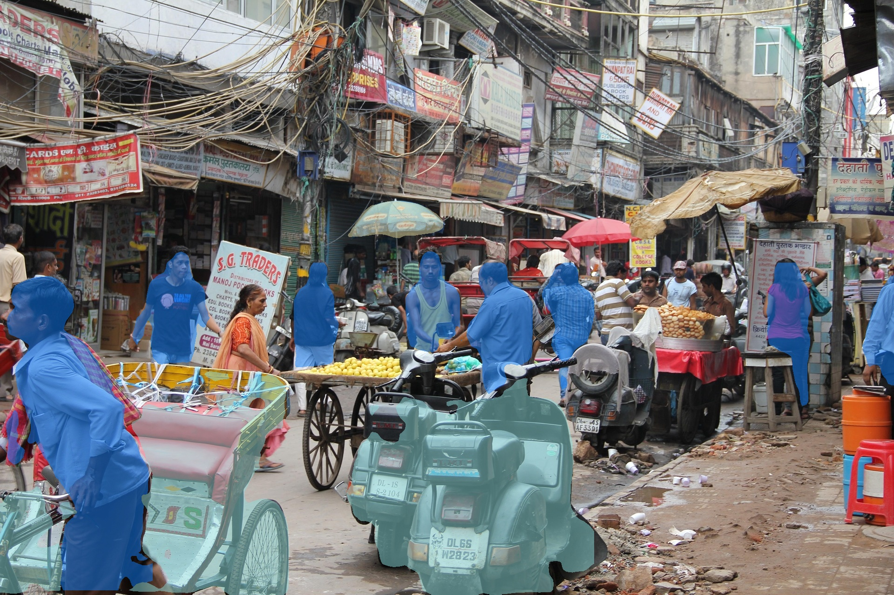

# Mask

<!--
summary: Color the exact pixels of each segmented object with a see-through mask, with pf.annotate.mask.
label: Mask
keywords: pixelflow, segmentation mask, draw masks, instance segmentation visualization, annotate mask
-->

A box covers the object and the background around it. A segmentation model also gives a mask: the
pixels that belong to the object. `pf.annotate.mask` colors those pixels.

```python
import pixelflow as pf
from mayaku import from_pretrained

predictor = from_pretrained("mayaku-n-seg")
result = predictor("street.jpg")
detections = pf.from_mayaku(result, labels=predictor.class_names)
detections = detections.filter_by_confidence(0.5)

image = pf.read_image("street.jpg")
image = pf.annotate.mask(image, detections)
pf.save_image("street-masks.jpg", image)
```



Detections without a mask are skipped. Where two masks overlap, the one later in the list takes
the pixel.

A mask must have the same width and height as the image; otherwise `mask` raises a `ValueError`.
That is the case for masks from every [converter](/docs/core-concepts/converters.md), as long as
you draw on the image at the size you gave the model:
[resize](/docs/utilities/transforms.md#resize) the picture after drawing, not before.

To draw only the edge of each object, use [`polygon`](/docs/visualization/polygon.md).

## Parameters

| Parameter | Default | |
|-----------|---------|---|
| `frame` | | RGB image, drawn on in place |
| `detections` | | the `Detections` whose masks to draw |
| `opacity` | `0.5` | from 0 (invisible) to 1 (solid color) |
| `colors` | the default palette | list of RGB colors, picked by `class_id` (see [colors](/docs/visualization/overview.md#colors-follow-the-class)) |
