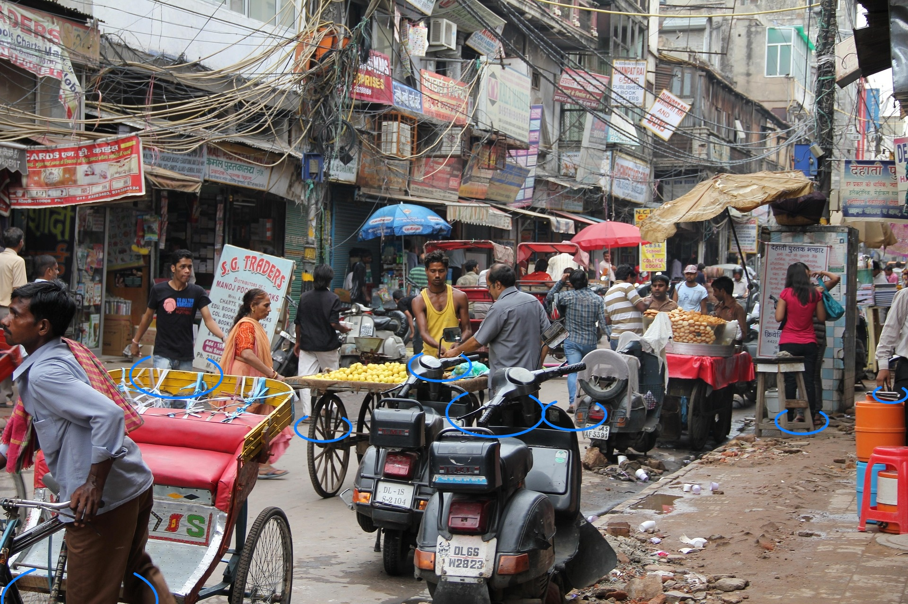

# Oval

<!--
summary: Draw an ellipse on the ground under each detection, the marker sports broadcasts put under players, with pf.annotate.oval.
label: Oval
keywords: pixelflow, ellipse marker, player marker, annotate oval, ground marker
-->

`pf.annotate.oval` draws an ellipse at the bottom of each box, where a person or a car meets the
ground. It marks objects without covering them, which works well for crowds and sports footage,
where boxes overlap and hide each other.

```python
import pixelflow as pf
from mayaku import from_pretrained

predictor = from_pretrained("mayaku-n-det")
result = predictor("street.jpg")
detections = pf.from_mayaku(result, labels=predictor.class_names)
detections = detections.filter_by_confidence(0.5)

people = detections.filter_by_class_id(predictor.class_names.index("Person"))

image = pf.read_image("street.jpg")
image = pf.annotate.oval(image, people)
pf.save_image("street-ovals.jpg", image)
```



The ellipse is centered on the bottom edge of the box. It is as wide as the box and a quarter as
tall as it is wide.

By default the arc leaves a gap at the top, behind the object's feet, so the line does not cross
the object itself. Angles are in degrees, measured clockwise from the right-hand side: the
default arc runs from -45 to 235, and `start_angle=0, end_angle=360` draws the full ellipse.

## Parameters

| Parameter | Default | |
|-----------|---------|---|
| `image` | | RGB image, drawn on in place |
| `detections` | | the `Detections` to mark |
| `thickness` | from the image size | line width in pixels: 4 on a 1920×1280 image |
| `start_angle` | `-45` | where the arc starts, in degrees |
| `end_angle` | `235` | where the arc ends, in degrees |
| `colors` | the default palette | list of RGB colors, picked by `class_id` (see [colors](/docs/visualization/overview.md#colors-follow-the-class)) |
