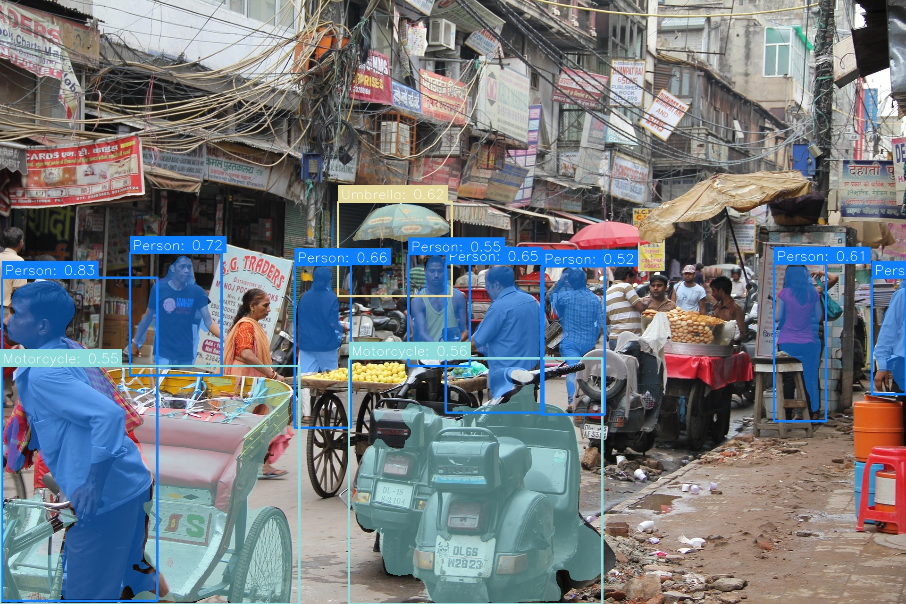

# Draw results on images

<!--
summary: How PixelFlow's drawing functions work: one call per layer, chained in order, drawn on the image you pass in, sized to the image and colored by class.
label: Overview
keywords: pixelflow, annotate, draw detections, visualization, colors
-->

Every drawing function lives in `pf.annotate` and takes the same two things: the image, and the
results to draw. Each one draws one kind of mark (boxes, labels, masks...), so you build a picture
by calling them one after the other.

```python
import pixelflow as pf
from mayaku import from_pretrained

predictor = from_pretrained("mayaku-n-seg")
result = predictor("street.jpg")
detections = pf.from_mayaku(result, labels=predictor.class_names)
detections = detections.filter_by_confidence(0.5)

image = pf.read_image("street.jpg")
image = pf.annotate.mask(image, detections)
image = pf.annotate.box(image, detections)
image = pf.annotate.label(image, detections)
pf.save_image("street-annotated.jpg", image)
```



## Order matters

Each call paints over what is already there. Draw the large, see-through marks first (masks,
filled boxes, zones) and the small, solid ones last (boxes, then labels), so the labels stay
readable.

## Drawing changes the image you pass in

The functions draw directly on the array you give them and return that same array. This avoids a
copy of every frame in a video, but it also means the original is gone. Pass a copy when you still
need it:

```python
original = pf.read_image("street.jpg")
annotated = pf.annotate.box(original.copy(), detections)
```

Images are RGB, as `pf.read_image` and `pf.VideoReader` return them. An image read with
`cv2.imread` is BGR: the drawing works, but every color comes out with red and blue swapped.

## Sizes follow the image

Line widths, font sizes, blur strength and the other sizes are worked out from the image size, so
the same code gives readable marks on a 640×480 frame and on a 4K photo. On the 1920×1280 photo
above, lines are 4 pixels wide. Every function takes the size as an argument (`thickness`,
`font_scale`, `radius`...) when you want to set it yourself.

## Colors follow the class

Each detection takes its color from its `class_id`, so every person has the same color, in every
function and in every frame of a video. With the default palette of 20 colors, class `n` gets
color `n % 20`. A detection without a `class_id` gets the first color.

Pass `colors` to use your own list of RGB colors, with the same rule:

```python
image = pf.annotate.box(image, detections, colors=pf.colors.PASTEL_PALETTE)
image = pf.annotate.box(image, detections, colors=[(255, 0, 0)])  # everything red
```

`pf.colors` has three palettes: `DEFAULT_PALETTE`, `VIBRANT_PALETTE` and `PASTEL_PALETTE`.

## All drawing functions

| Function | Draws | Needs |
|----------|-------|-------|
| [`box`](/docs/visualization/box.md) | the outline of each box | boxes |
| [`filled_box`](/docs/visualization/filled-box.md) | see-through filled boxes | boxes |
| [`label`](/docs/visualization/label.md) | text next to each box | boxes |
| [`mask`](/docs/visualization/mask.md) | see-through masks | masks |
| [`polygon`](/docs/visualization/polygon.md) | the outline of each object | outlines |
| [`oval`](/docs/visualization/oval.md) | an ellipse under each object | boxes |
| [`anchors`](/docs/visualization/anchors.md) | dots at the corners, center or edges of each box | boxes |
| [`keypoint`](/docs/visualization/keypoint.md) | a dot on each keypoint | keypoints |
| [`keypoint_skeleton`](/docs/visualization/keypoint-skeleton.md) | lines between keypoints | named keypoints |
| [`classification`](/docs/visualization/classification.md) | the top classes in a corner | classifications |
| [`blur`](/docs/visualization/blur.md) | each box blurred | boxes |
| [`pixelate`](/docs/visualization/pixelate.md) | each box pixelated | boxes |
| [`zones`](/docs/visualization/zones.md) | zones and their counts | `Zones` |
| [`crossings`](/docs/visualization/crossings.md) | lines and their in/out counts | `Crossings` |
| [`grid_overlay`](/docs/visualization/grid-overlay.md) | a grid inside each box | boxes |
| [`fps_counter`](/docs/visualization/fps-counter.md) | frames per second | a video loop |
