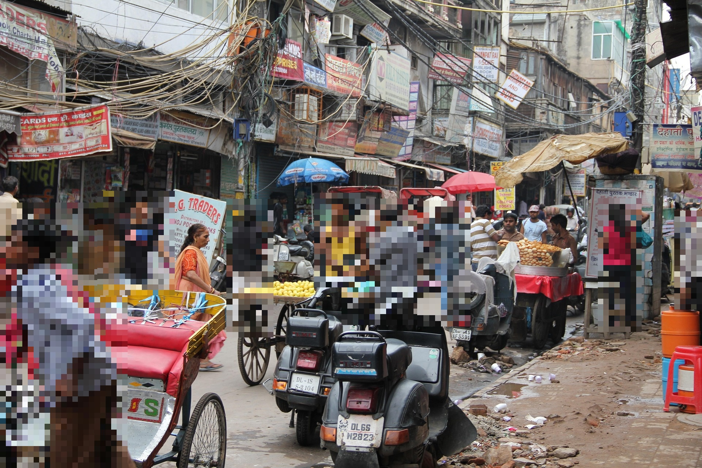

# Pixelate

<!--
summary: Hide people, faces or license plates behind large square blocks with pf.annotate.pixelate.
label: Pixelate
keywords: pixelflow, pixelate faces, mosaic, anonymize, privacy, annotate pixelate
-->

`pf.annotate.pixelate` replaces the inside of each box with large square blocks. Like
[blur](/docs/visualization/blur.md), it hides who is in the image; the blocks also show plainly
that something was hidden on purpose.

```python
import pixelflow as pf
from mayaku import from_pretrained

predictor = from_pretrained("mayaku-n-det")
result = predictor("street.jpg")
detections = pf.from_mayaku(result, labels=predictor.class_names)
detections = detections.filter_by_confidence(0.5)

people = detections.filter_by_class_id(predictor.class_names.index("Person"))

image = pf.read_image("street.jpg")
image = pf.annotate.pixelate(image, people)
pf.save_image("street-pixelated.jpg", image)
```



The box is shrunk to a few pixels and blown back up, so each block is one flat color taken from the
area it covers; larger blocks hide more. Each box is grown by `padding_percent` on every side
first. A box smaller than one block is left as it is.

## Parameters

| Parameter | Default | |
|-----------|---------|---|
| `image` | | image, changed in place |
| `detections` | | the `Detections` to pixelate |
| `pixel_size` | from the image size | width of each block in pixels: 15 on a 1920×1280 image |
| `padding_percent` | `0.05` | how much to grow each box on every side, as a share of its width and height, from 0 to 0.5 |
