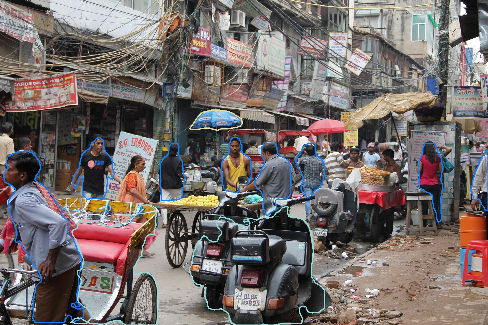

# Polygon

<!--
summary: Draw the outline of each segmented object as a line with pf.annotate.polygon, from the detection's segments.
label: Polygon
keywords: pixelflow, draw polygon, object outline, segmentation contour, annotate polygon
-->

`pf.annotate.polygon` draws the outline of each object as a line. It shows the shape as clearly as
a [mask](/docs/visualization/mask.md) and leaves the object itself uncovered.

```python
import pixelflow as pf
from mayaku import from_pretrained

predictor = from_pretrained("mayaku-n-seg")
result = predictor("street.jpg")
detections = pf.from_mayaku(result, labels=predictor.class_names)
detections = detections.filter_by_confidence(0.5)
detections.masks_to_segments()

image = pf.read_image("street.jpg")
image = pf.annotate.polygon(image, detections)
pf.save_image("street-outlines.jpg", image)
```



`polygon` draws each detection's `segments`, its outline as `[[x, y], ...]` points. Mayaku gives
masks, so `masks_to_segments()` traces an outline from each mask first. Some converters fill
`segments` directly, such as `from_ultralytics` for segmentation models and `from_easyocr` for
text: those need no extra step. Detections without an outline are skipped.

See [masks and outlines](/docs/core-concepts/detections.md#masks-and-outlines) for how outlines
are made.

## Parameters

| Parameter | Default | |
|-----------|---------|---|
| `image` | | RGB image, drawn on in place |
| `detections` | | the `Detections` whose outlines to draw |
| `thickness` | from the image size | line width in pixels: 4 on a 1920×1280 image |
| `colors` | the default palette | list of RGB colors, picked by `class_id` (see [colors](/docs/visualization/overview.md#colors-follow-the-class)) |
