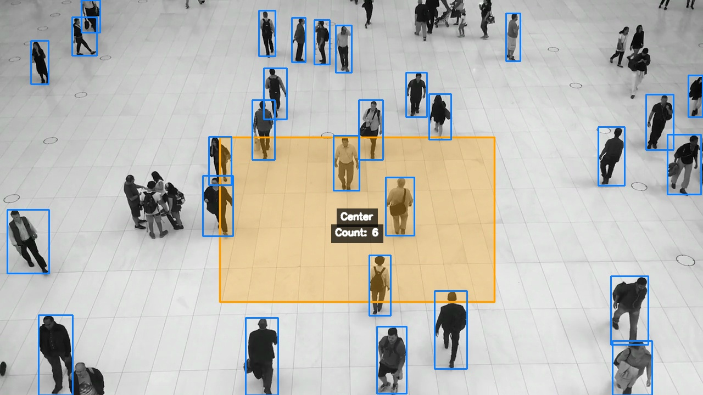

# Zones

<!--
summary: Draw the areas of a Zones object, with their names and the number of objects inside, with pf.annotate.zones.
label: Zones
keywords: pixelflow, draw zones, polygon zone, region count, annotate zones
-->

A zone is an area of the image, such as a doorway, a lane or a shelf, that counts the objects
inside it. `pf.annotate.zones` draws every zone of a `pf.Zones` object, with its name and its
count, so you can check the area covers what you meant.

```python
import pixelflow as pf
from mayaku import from_pretrained

predictor = from_pretrained("mayaku-n-det")
result = predictor("crowd.jpg")
detections = pf.from_mayaku(result, labels=predictor.class_names)
detections = detections.filter_by_confidence(0.5)

zones = pf.Zones()
zones.add_zone([(400, 250), (900, 250), (900, 550), (400, 550)], name="Center", color=(255, 160, 0))
zones.update(detections, strategy="bottom_center")

image = pf.read_image("crowd.jpg")
image = pf.annotate.zones(image, zones)
image = pf.annotate.box(image, detections)
pf.save_image("crowd-zone.jpg", image)
```



`zones` draws what `Zones` holds: the area, its name and the count from the last `update()`. Draw
after `update()`, or the counts are those of the previous frame. On a tracked video, the label
also shows how many objects have entered so far, as `Count: <inside now> (Total: <entered>)`. See
[count objects in a zone](/docs/tracking/zones.md) for how objects are counted.

Without a `color`, each zone gets its own, picked from its id; pass `color` when you add it to choose.

## Parameters

| Parameter | Default | |
|-----------|---------|---|
| `image` | | RGB image, drawn on in place |
| `zone_manager` | | the `pf.Zones` to draw |
| `opacity` | `0.3` | fill opacity, from 0 (invisible) to 1 (solid) |
| `border_thickness` | from the image size | border width in pixels |
| `show_counts` | `True` | write the count |
| `show_names` | `True` | write the zone name |
| `font_scale` | from the image size | text size |
| `font_thickness` | from the image size | text stroke width in pixels |
| `text_color` | white | RGB color of the text |
| `text_bg_color` | black | RGB color behind the text |
| `text_bg_opacity` | `0.7` | opacity of the background behind the text |
| `count_position` | `"center"` | where the text goes: `"center"`, `"top"` or `"bottom"` of the zone |
| `draw_filled` | `True` | fill the zone |
| `draw_border` | `True` | draw the zone's border |
